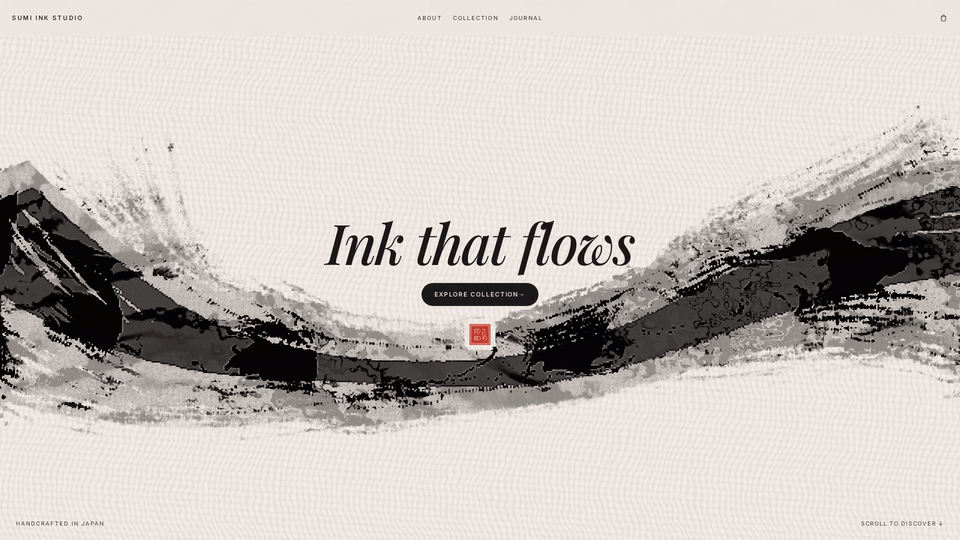

<div align="center">

# react-sumi-ink

Tinta sumi-e com simulacao fluida real para React. WebAssembly (Rust), WebGL2 e mascara do DOM via `data-ink`.

**[Demo ao vivo](https://lenderson00.github.io/react-sumi-ink/)**

[](LICENSE)




</div>

## Visao geral

`react-sumi-ink` coloca uma camada de tinta interativa sobre seu React tree. A velocidade vive num grid grosso. O pigmento (nucleo nitido, fluxo e lavagem) vive num grid 2x a 4x maior, com pincel de cerdas, respingos e secagem. O fragment shader faz a borda rasgada, a granulacao e a fibra do washi.

O diferencial: a tinta conhece o layout. Filhos de `<InkStage>` com `data-ink="obstacle" | "absorb" | "repel"` viram obstaculos no grid. A mascara atualiza com `ResizeObserver` e `MutationObserver`, sem rasterizar o DOM inteiro.

Sibling de [react-glass-lens](https://github.com/lenderson00/react-glass-lens): mesma filosofia de DX (presets, props table, ref imperativa, playground, hash routes).

## Recursos

- Simulacao fluida real em WASM, worker com OffscreenCanvas quando disponivel
- Sumi-e: sangramento anisotropo, borda mais escura ao secar, traco seco em alta velocidade
- `data-ink` por elemento: contorno, absorcao ou repulsao
- Modos `trail`, `paint`, `ambient`, `static`
- Presets: `sumi`, `wash`, `calligraphy`, `smoke`, `koi`, `minimal`
- `<InkButton>`, hook `useInk()`, API imperativa (`splash`, `stroke`, `clear`, `dry`, `snapshot`)
- Fallback: sem WASM ou WebGL2, filhos continuam visiveis e `onError` dispara
- ESM + CJS + `.d.ts`, WASM incluso no pacote

## Instalacao

Repositorio MIT. Ainda nao publicado no npm (use o GitHub ou monorepo local).

```sh
npm i react-sumi-ink
```

Peer: React 18 ou 19.

## Uso

```tsx
import { InkStage } from 'react-sumi-ink';

export function Hero() {
  return (
    <InkStage preset="sumi" mode="paint" style={{ height: 480 }}>
      <h1 data-ink="obstacle">Titulo</h1>
      <button data-ink="repel">Repel</button>
    </InkStage>
  );
}
```

### Vite

Nenhuma configuracao extra. O pacote resolve o `.wasm` via `import.meta.url`.

### Next.js 15

```tsx
import dynamic from 'next/dynamic';

const InkStage = dynamic(() => import('react-sumi-ink').then((m) => m.InkStage), { ssr: false });
```

Copie ou sirva `node_modules/react-sumi-ink/wasm/pkg/sumi_ink_sim_bg.wasm` se o bundler nao embutir assets.

## Tamanho (gzip, build 0.1.0)

| Artefato | gzip |
| --- | --- |
| `dist/index.js` (lib TS) | ~5.9 kB |
| `sumi_ink_sim_bg.wasm` | ~29 kB |
| Total tipico | ~35 kB |

## Performance (Chrome, referencia)

| Cenario | Resultado |
| --- | --- |
| Paint no desktop, grid medio | 55 a 60 fps |
| Android medio, `quality="auto"` | 45 a 58 fps |
| Passo WASM 128 x 96 | ~1.0 a 1.4 ms |
| Draw WebGL2 viewport cheio | ~0.5 a 0.8 ms GPU |

## Desenvolvimento

```sh
npm ci
npm run dev          # playground em :5198
npm run build        # lib + site
npm run test:rust
npm run clippy
```

WASM:

```sh
npm run build:wasm -w react-sumi-ink
```

## Licenca

MIT, Lenderson Macedo.